<!-- Built by the LinkedIn planner (tools/github_profile.py) from linkedin/profile.yaml, cv/cv.yaml and the LinkedIn
     series. Edit those and publish again: changes made here are overwritten. -->

<a href="https://www.linkedin.com/in/mohamed-elsaeed-elmenshawy"></a>

<h3>I'm a forward deployed AI engineer: I take a real business problem and turn it into an AI solution that people use every day.</h3>

<a href="https://www.linkedin.com/in/mohamed-elsaeed-elmenshawy"><picture><source media="(prefers-color-scheme: dark)" srcset="assets/link-1-dark.svg"></picture></a>&nbsp;<a href="mailto:mohamed.smenshawy@gmail.com"><picture><source media="(prefers-color-scheme: dark)" srcset="assets/link-2-dark.svg"></picture></a>&nbsp;<a href="https://ieeexplore.ieee.org/document/11584123"><picture><source media="(prefers-color-scheme: dark)" srcset="assets/link-3-dark.svg"></picture></a>&nbsp;<a href="https://www.kaggle.com/mohamedmenshawy424"><picture><source media="(prefers-color-scheme: dark)" srcset="assets/link-4-dark.svg"></picture></a>

<b>The full story</b>

I graduated with Honors from the German University in Cairo: B.Sc. in Media Engineering and Technology, major Computer Science and Engineering, with an Excellent cumulative grade and an Excellent bachelor thesis. Since December 2025 I have worked as a Forward Deployed AI Engineer at Misr Italia Properties.

What I work on:

- **AI colleagues**: AI agents that are hired, not coded. Each one gets a work identity, a human manager, a versioned job description and permissions enforced outside the model, so adding a new one is configuration, not a new deployment. I lead the engineering of this platform.
- **Arabic speech AI**: Whisper large-v3 fine-tuned on Egyptian Arabic sales calls and served as an API with voice-activity detection and call analysis.
- **RAG**: lead generation from public social-media posts (multilingual embeddings, vector + graph retrieval) and a sales analysis pipeline.
- **Earlier AI work**: a multi-agent assistant for employees' daily work (A2A protocol), a Graph-RAG travel assistant on a Neo4j knowledge graph, and an Alzheimer's MRI classifier (MobileNet CNN).

How I work, forward deployed: I start from the work of the people who will use the AI, build the solution end to end, connect it to the systems they already rely on (such as SAP and Microsoft 365), ship it, and keep improving it after launch. Written specs before code, tests before claims, and safety controls outside the model. A full-stack background means I can deliver the whole product, not only the model.

Before AI engineering: SAP internships (ABAP, BTP, S/4HANA) at SAP Egypt, Hassan Allam Holding and CIC; backend development at Talaat Moustafa Group; junior teaching assistant for Java and Python at GUC; head of the web development committee at GDG GUC. Co-author of an IEEE conference paper (ICEENG 2026) on weather-adaptive task allocation for vehicle fleets in disaster relief.

I'm writing a series, "AI Colleagues: Hired, Not Coded", about treating AI agents like new hires. Follow along, or message me about deploying AI agents in a real business, LLM engineering or Arabic speech AI.

 

<picture><source media="(prefers-color-scheme: dark)" srcset="assets/title-now-dark.svg"></picture>

<a href="https://www.linkedin.com/in/mohamed-elsaeed-elmenshawy/recent-activity/all/"><picture><source media="(prefers-color-scheme: dark)" srcset="assets/now-dark.svg"></picture></a>

 

<picture><source media="(prefers-color-scheme: dark)" srcset="assets/title-work-dark.svg"></picture>

<picture><source media="(prefers-color-scheme: dark)" srcset="assets/focus-dark.svg"></picture>

<picture><source media="(prefers-color-scheme: dark)" srcset="assets/method-dark.svg"></picture>

 

<picture><source media="(prefers-color-scheme: dark)" srcset="assets/title-projects-dark.svg"></picture>

<a href="https://www.linkedin.com/in/mohamed-elsaeed-elmenshawy/details/projects/"><picture><source media="(prefers-color-scheme: dark)" srcset="assets/project-1-dark.svg"></picture></a>&nbsp;<a href="https://www.linkedin.com/in/mohamed-elsaeed-elmenshawy/details/projects/"><picture><source media="(prefers-color-scheme: dark)" srcset="assets/project-2-dark.svg"></picture></a>

<a href="https://www.linkedin.com/in/mohamed-elsaeed-elmenshawy/details/projects/"><picture><source media="(prefers-color-scheme: dark)" srcset="assets/project-3-dark.svg"></picture></a>&nbsp;<a href="https://www.linkedin.com/in/mohamed-elsaeed-elmenshawy/details/projects/"><picture><source media="(prefers-color-scheme: dark)" srcset="assets/project-4-dark.svg"></picture></a>

<a href="https://www.linkedin.com/in/mohamed-elsaeed-elmenshawy/details/projects/"><picture><source media="(prefers-color-scheme: dark)" srcset="assets/project-5-dark.svg"></picture></a>&nbsp;<a href="https://neura-scan-md.netlify.app/"><picture><source media="(prefers-color-scheme: dark)" srcset="assets/project-6-dark.svg"></picture></a>

 

<picture><source media="(prefers-color-scheme: dark)" srcset="assets/title-path-dark.svg"></picture>

<picture><source media="(prefers-color-scheme: dark)" srcset="assets/path-dark.svg"></picture>

 

<picture><source media="(prefers-color-scheme: dark)" srcset="assets/title-toolbox-dark.svg"></picture>

<picture><source media="(prefers-color-scheme: dark)" srcset="assets/toolbox-dark.svg"></picture>

 

<picture><source media="(prefers-color-scheme: dark)" srcset="assets/title-research-dark.svg"></picture>

<a href="https://ieeexplore.ieee.org/document/11584123"><picture><source media="(prefers-color-scheme: dark)" srcset="assets/paper-dark.svg"></picture></a>

<a href="https://www.coursera.org/account/accomplishments/specialization/BOYHY55YO06D"><picture><source media="(prefers-color-scheme: dark)" srcset="assets/cert-1-dark.svg"></picture></a>&nbsp;<a href="https://coursera.org/share/df4902e589858e36b27b7f4c2eb07bd0"><picture><source media="(prefers-color-scheme: dark)" srcset="assets/cert-2-dark.svg"></picture></a>&nbsp;<a href="https://coursera.org/share/9e4f124fc43a1b113ba0537f39ea13f1"><picture><source media="(prefers-color-scheme: dark)" srcset="assets/cert-3-dark.svg"></picture></a>

 

<picture><source media="(prefers-color-scheme: dark)" srcset="assets/title-activity-dark.svg"></picture>

<picture><source media="(prefers-color-scheme: dark)" srcset="https://raw.githubusercontent.com/MohamedElsaeed424/MohamedElsaeed424/output/activity-dark.svg"></picture>

<picture><source media="(prefers-color-scheme: dark)" srcset="https://raw.githubusercontent.com/MohamedElsaeed424/MohamedElsaeed424/output/snake-dark.svg"></picture>

 

<a href="https://www.linkedin.com/in/mohamed-elsaeed-elmenshawy"></a>

This page rebuilds itself from my LinkedIn profile, CV and posting plan, so it is always current.

